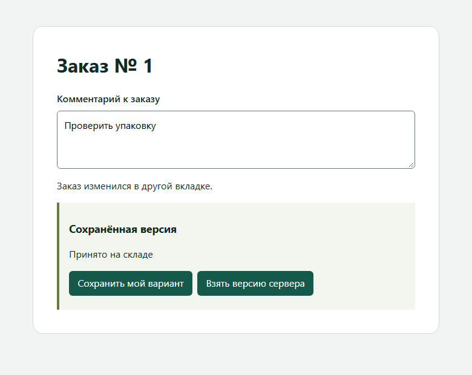

# Две вкладки сохраняют одну карточку

## Посмотреть конфликт в интерфейсе



[Компонент React / TypeScript](form.tsx) отправляет версию карточки в [локальный HTTP-сервис](server.py). Две вкладки используют одну временную БД. После 409 оператор может оставить свой текст или загрузить версию сервера. Повторный конфликт при сохранении разбирается тем же способом.

В папке `forms` выполните `npm ci`, затем `npm run build` и `python server.py`. Откройте адрес из терминала в двух вкладках. Для браузерного теста установите Chromium командой `npx playwright install chromium` и выполните `npm test`. Если браузер уже установлен, путь к исполняемому файлу можно указать в `CHROMIUM_PATH`. Тест сверяет ответ HTTP, текст обеих версий и запись в БД через отдельное чтение API. [Браузерный тест](browser.test.mjs).

Регрессию можно увидеть отдельно: если условный UPDATE перестанет учитывать версию, оба клиента получат успех. В конце останется только последний текст. Проверка ждёт 409 и сохранённый черновик, поэтому зелёный результат при таком изменении невозможен.

Два клиента читают одну версию и одновременно отправляют разные изменения. Условный UPDATE пропускает ровно одно. Проигравший получает актуальную запись и свой черновик. В тесте можно сверить оба ответа с тем, что в итоге записано в БД.

Из корня репозитория:

```console
python forms/04_concurrent_version_conflict_test.py
```

Здесь проверяется контракт сохранения на SQLite. Ответы 200, 404 и 409 моделируются без HTTP-сервера.
